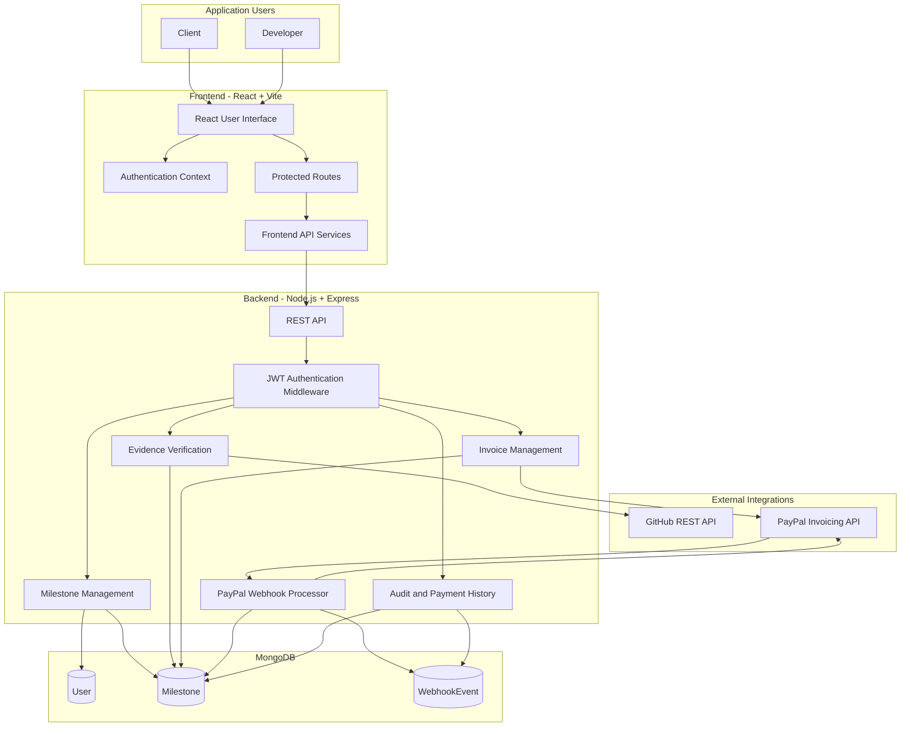
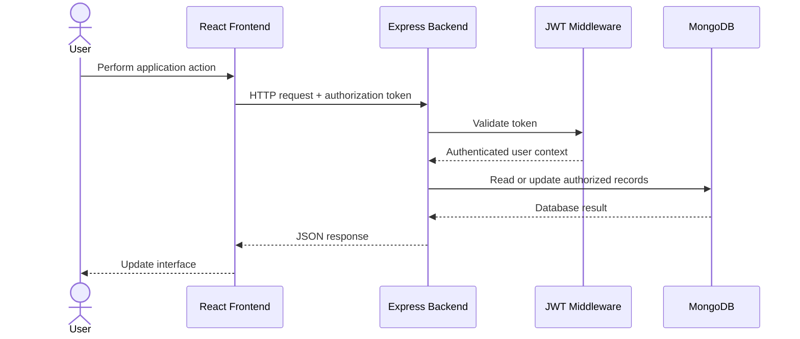
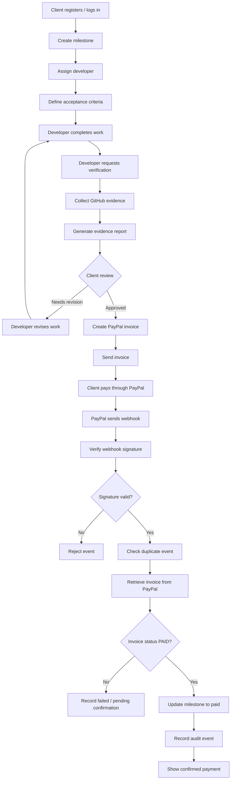
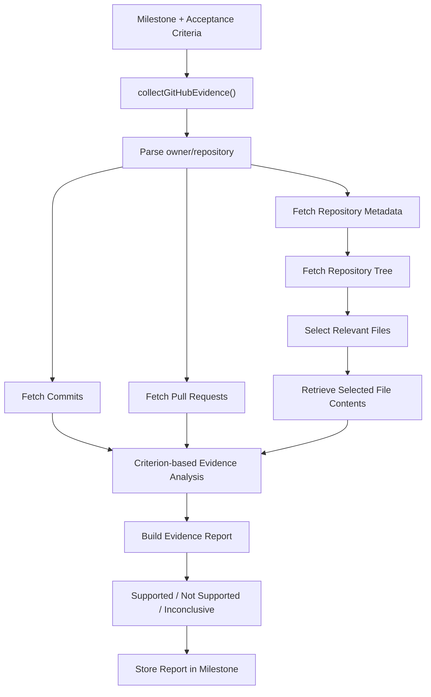
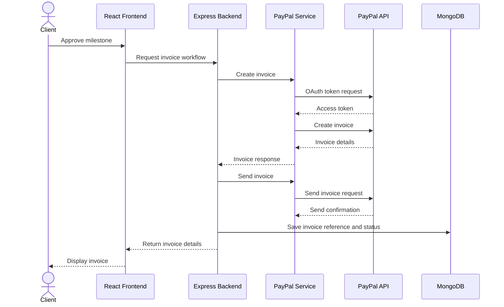
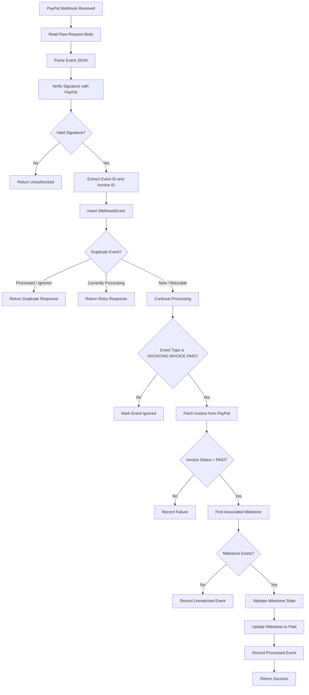
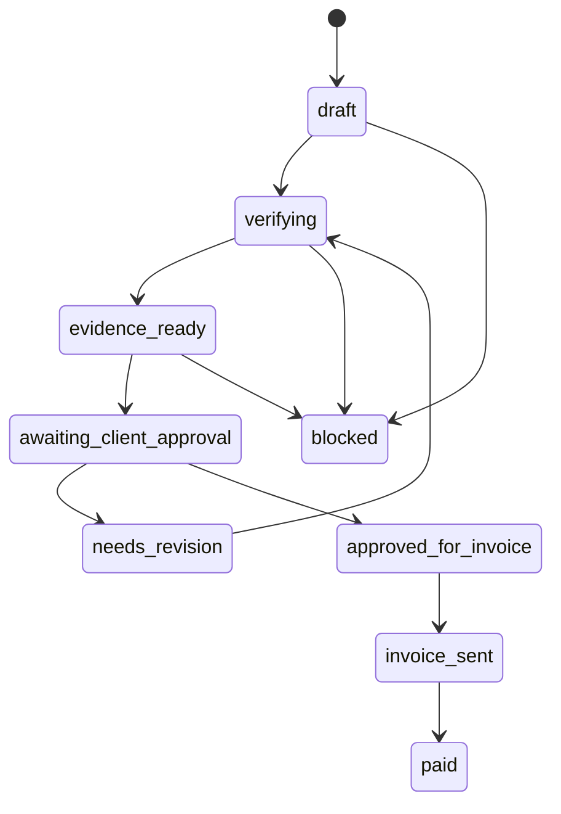
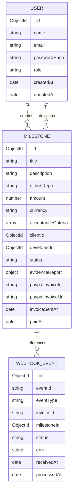

# ProofPay AI

### AI-Assisted Milestone Verification & Automated Payment Platform

**Verify the work. Approve the milestone. Release payment with confidence.**

ProofPay AI is a milestone-based project delivery and payment management platform designed to improve trust between clients and developers. It connects project requirements, GitHub-based development evidence, milestone approvals, PayPal invoicing, and payment confirmation into one structured workflow.

Instead of relying entirely on manual progress updates and informal payment agreements, ProofPay creates a traceable process in which deliverables are associated with acceptance criteria, evidence is collected from GitHub, and payments are confirmed through PayPal's verified webhook workflow.

---

## Table of Contents

1. [Overview](#-overview)
2. [The Problem](#-the-problem)
3. [Our Solution](#-our-solution)
4. [Core Features](#-core-features)
5. [User Roles](#-user-roles)
6. [System Architecture](#-system-architecture)
7. [Complete Working Process](#-complete-working-process)
8. [GitHub Evidence Verification Engine](#-github-evidence-verification-engine)
9. [PayPal Payment Architecture](#-paypal-payment-architecture)
10. [Milestone State Machine](#-milestone-state-machine)
11. [Database Architecture](#-database-architecture)
12. [Project Structure](#-project-structure)
13. [Technology Stack](#-technology-stack)
14. [API Documentation](#-api-documentation)
15. [Installation and Setup](#-installation-and-setup)
16. [Environment Configuration](#-environment-configuration)
17. [Running the Application](#-running-the-application)
18. [Testing and Validation](#-testing-and-validation)
19. [Security Architecture](#-security-architecture)
20. [Error Handling and Troubleshooting](#-error-handling-and-troubleshooting)
21. [Current Limitations and Future Improvements](#-current-limitations-and-future-improvements)
22. [Contributing](#-contributing)
23. [License](#-license)

---

## 1. Overview

ProofPay AI brings together three important parts of software project delivery:

| Component | Responsibility |
|---|---|
| Milestone Management | Defines project deliverables, developers, payment amounts, and acceptance criteria |
| GitHub Evidence Verification | Collects development evidence and generates criterion-based verification reports |
| PayPal Payment Automation | Creates invoices and confirms completed payments through verified webhooks |

### The central idea

A payment should be associated with an agreed deliverable, not simply with a developer's claim that work is complete.

ProofPay establishes a structured relationship:

**Milestone → Acceptance Criteria → Development Evidence → Client Approval → Invoice → Verified Payment**

### Project Repository

[GitHub Repository – ProofPay AI](https://github.com/deep453/ProofPay-AI)

---

## 2. The Problem

Traditional freelance and milestone-based development workflows often involve several challenges.

**For clients:**
- Difficulties in independently checking whether development work has been completed.
- Limited visibility into actual development activity.
- Uncertainty about whether submitted work satisfies agreed requirements.
- Manual invoice and payment tracking.
- Difficulty maintaining a reliable history of project decisions.

**For developers:**
- Delayed payments due to unclear approval processes.
- Repeated requests to demonstrate completed work.
- Disputes over whether deliverables satisfy project requirements.
- Fragmented communication and payment records.

### Why this matters

A development milestone is more than a payment entry. It represents an agreement between two parties about what must be delivered and how completion will be assessed.

ProofPay aims to make that agreement traceable.

---

## 3. Our Solution

ProofPay introduces an integrated workflow with four major stages.

1. **Define:** A client creates a milestone containing its description, GitHub repository, assigned developer, amount, currency, and acceptance criteria.
2. **Verify:** The developer triggers verification. The backend retrieves repository information and relevant development evidence, then generates a report against the criteria.
3. **Approve:** The client reviews the evidence and makes the milestone approval decision.
4. **Pay:** Once the approval and invoice workflow permits it, ProofPay creates and sends a PayPal invoice. Payment is confirmed through PayPal's webhook and an independent invoice-status check.

The platform maintains milestone and payment information in MongoDB, allowing both parties to view relevant project activity.

---

## 4. Core Features

### 4.1 Dual-role authentication

ProofPay supports two user roles:

- **Client:** Creates milestones, assigns developers, reviews verification results, and manages approvals and invoices.
- **Developer:** Views assigned milestones, tracks progress, and initiates verification.

Authentication uses password hashing and signed JSON Web Tokens.

### 4.2 Milestone management

Each milestone contains:

- Title
- Description
- GitHub repository
- Assigned client
- Assigned developer
- Payment amount
- Currency
- Acceptance criteria
- Current status
- Evidence report
- PayPal invoice details
- Payment timestamps

A milestone must contain at least one acceptance criterion.

### 4.3 GitHub integration

ProofPay retrieves relevant information from GitHub, including:

- Repository information
- Commit history
- Pull requests
- Repository file structure
- Selected source files
- Selected test files

This information is used to generate a report associated with the milestone's acceptance criteria.

### 4.4 Criterion-based evidence reports

Each acceptance criterion can receive one of three outcomes:

| Result | Meaning |
|---|---|
| `supported` | Available evidence supports the criterion |
| `not_supported` | The collected evidence does not support the criterion |
| `inconclusive` | Available evidence is insufficient to reach a conclusion |

The report also contains explanations, linked evidence, and collection limitations.

### 4.5 PayPal invoicing

ProofPay integrates with the PayPal Invoicing API.

The backend can:
- Authenticate with PayPal using OAuth 2.0 client credentials.
- Create an invoice.
- Send an invoice to its recipient.
- Retrieve invoice details.
- Store invoice identifiers and URLs against milestones.

### 4.6 Verified payment confirmation

ProofPay does not rely solely on a browser redirect or a client-side payment message.

The backend:
1. Receives the PayPal webhook.
2. Verifies the webhook signature.
3. Records the event.
4. Checks for duplicate deliveries.
5. Retrieves the invoice directly from PayPal.
6. Confirms that its current status is `PAID`.
7. Updates the associated milestone.
8. Records the processing result.

### 4.7 Audit history

Webhook events are stored in MongoDB with event identifiers, invoice references, processing states, timestamps, and error information.

This makes payment-related events traceable.

### 4.8 Dashboards and reporting

The React frontend includes role-specific dashboards and interfaces for milestones, invoices, payments, verification results, profiles, settings, and audit history.

---

## 5. User Roles

### Client workflow

1. Register or log in as a client.
2. Select a registered developer.
3. Create a milestone.
4. Enter the GitHub repository and acceptance criteria.
5. Monitor the milestone.
6. Review its evidence report.
7. Approve or request revisions through the supported workflow.
8. Track the associated invoice and payment.

### Developer workflow

1. Register or log in as a developer.
2. View assigned milestones.
3. Understand the expected acceptance criteria.
4. Complete the required development work.
5. Submit work for verification.
6. Review the generated evidence report.
7. Follow the milestone and payment status.

---

## 6. System Architecture

The system follows a frontend–backend architecture with dedicated integrations for GitHub and PayPal.

### 6.1 High-level architecture



### 6.2 Architecture responsibilities

| Layer | Main responsibility |
|---|---|
| React frontend | User interaction, dashboards, forms, and role-based navigation |
| API service layer | Communicates with backend endpoints |
| Express backend | Business logic and REST API |
| Authentication middleware | Validates JWTs and provides authenticated user context |
| Milestone services | Manage project and milestone workflows |
| GitHub services | Retrieve repository and development evidence |
| PayPal services | Create invoices, authenticate, retrieve invoice status, and verify webhooks |
| MongoDB | Persistent application and audit data |

### 6.3 Request-response flow



---

## 7. Complete Working Process

### Stage 1: Account registration

A user registers with their name, email, password, and role.

The backend:
- Validates input.
- Normalizes the email address.
- Checks for an existing account.
- Hashes the password with bcrypt.
- Stores the user record.

### Stage 2: Milestone creation

The client supplies:

```json
{
  "title": "Login Page Implementation",
  "description": "Implement a secure login interface",
  "githubRepo": "owner/repository",
  "amount": 150,
  "currency": "USD",
  "developerEmail": "developer@example.com",
  "acceptanceCriteria": [
    {
      "title": "Login form",
      "description": "The application must contain a working login form"
    },
    {
      "title": "Input validation",
      "description": "The form must validate user input"
    }
  ]
}
```

The backend checks the request, confirms that the selected developer exists, and creates the milestone.

### Stage 3: Development

The assigned developer completes the work in the associated GitHub repository.

The repository becomes the source of development evidence used during verification.

### Stage 4: Verification request

The developer triggers verification for an eligible milestone.

The backend checks:
- Whether the milestone exists.
- Whether the authenticated user is a developer.
- Whether the developer is assigned to that milestone.
- Whether the milestone is in the expected `verifying` state.

### Stage 5: Evidence collection

The evidence collector retrieves repository information, commits, pull requests, repository files, and selected file contents.

Relevant files are selected using acceptance-criterion keywords and file metadata.

### Stage 6: Evidence report generation

The report builder associates available evidence with the acceptance criteria.

The report stores:
- Criterion identifier and title
- Result
- Explanation
- Supporting evidence
- Evidence collection limitations
- Repository reference
- Generation timestamp

### Stage 7: Client review

The client reviews the generated report and the milestone's evidence.

Approval and revision decisions remain part of the business workflow; evidence generation itself should not be treated as automatic client approval.

### Stage 8: Invoice creation and delivery

When the milestone reaches the permitted invoicing stage, the backend communicates with PayPal to create and send the invoice.

The invoice identifier and relevant invoice details are stored against the milestone.

### Stage 9: Payment

The client completes payment through PayPal.

PayPal sends a webhook event to the backend.

### Stage 10: Payment confirmation

The webhook processor validates the event and checks the invoice's current status directly with PayPal.

Only after the required checks succeed does the milestone move to its paid state.

### End-to-end workflow diagram



---

## 8. GitHub Evidence Verification Engine

The evidence verification subsystem is one of the central components of ProofPay.

Its purpose is to collect development information and organize it around the requirements of a milestone.

### 8.1 Evidence collection architecture



### 8.2 Repository validation

The collector expects the repository in this format:

```text
owner/repository
```

For example:

```text
deep453/Skill_Nova
```

The collector obtains:
- Repository metadata
- Default branch information
- Commit history
- Pull requests
- Repository tree

### 8.3 Relevant file selection

The current evidence collector supports common source and test file extensions, including:

- JavaScript and TypeScript
- Python
- Java
- C and C++
- Go and Rust
- PHP
- Vue
- HTML and CSS

It excludes common generated or dependency directories such as:

- `node_modules`
- `dist`
- `build`
- `coverage`
- `.git`

It also uses criterion keywords to prioritize relevant files.

The current implementation limits selection to 20 files and excludes files larger than 100 KB.

### 8.4 Criterion matching

Evidence is associated with acceptance criteria using keyword-based matching across available repository information.

Examples of collected evidence include:

| Evidence type | Example |
|---|---|
| Repository | Repository metadata |
| Commit | A commit implementing a feature |
| Pull request | A development pull request |
| Source file | A relevant implementation file |
| Test file | A related automated test |

### 8.5 Evidence report structure

A simplified example:

```json
{
  "repository": "owner/repository",
  "findings": [
    {
      "criterionTitle": "Login form",
      "result": "supported",
      "explanation": "Relevant implementation evidence was found.",
      "evidence": [
        {
          "type": "source_file",
          "title": "Login component",
          "url": "https://github.com/owner/repository/blob/main/src/Login.jsx"
        }
      ]
    }
  ],
  "limitations": []
}
```

This is an illustrative response structure, not a guaranteed output for every repository.

### Important distinction

The current evidence report is a criterion-based evidence analysis mechanism. A `supported` result means that collected evidence supports a criterion; it does not constitute a formal proof that software behaves correctly in every environment.

Human review remains important.

---

## 9. PayPal Payment Architecture

ProofPay integrates with PayPal's Invoicing API.

### 9.1 Invoice creation flow



### 9.2 OAuth authentication

The backend authenticates using:

```text
PAYPAL_CLIENT_ID
PAYPAL_CLIENT_SECRET
```

The PayPal service requests an OAuth access token and uses it for subsequent API operations.

The environment determines whether the Sandbox or Live API endpoint is selected.

### 9.3 Invoice details

The invoice includes:
- Invoice number
- Currency
- Reference
- Description
- Recipient email
- Invoicer information
- Line item
- Amount
- Payment terms

The current implementation uses a `NET_10` payment term.

### 9.4 Why webhooks matter

A frontend redirect is not sufficient evidence that a payment has completed.

A user might close the browser, a redirect might fail, or a payment flow might not finish successfully.

A server-to-server webhook provides a separate payment notification that the backend can validate.

### 9.5 Secure webhook processing



### 9.6 Idempotency

PayPal can deliver the same webhook more than once.

ProofPay uses the unique webhook event identifier to prevent the same event from being processed repeatedly.

Webhook processing states:

| Status | Meaning |
|---|---|
| `received` | Event received |
| `processing` | Event currently being processed |
| `processed` | Event successfully processed |
| `ignored` | Event intentionally not applied |
| `failed` | Processing failed and may require investigation or retry |

### 9.7 Independent payment verification

For a payment event, the backend retrieves the invoice from PayPal and checks:

```text
invoice.status === "PAID"
```

It then associates the invoice with the milestone and updates the milestone using a conditional database operation.

This protects the payment workflow from relying exclusively on the webhook's reported event type.

---

## 10. Milestone State Machine

Milestone statuses represent the progress of a deliverable through its lifecycle.

The current schema defines:

| Status | Meaning |
|---|---|
| `draft` | Milestone created |
| `verifying` | Verification is in progress |
| `evidence_ready` | Evidence report generated |
| `awaiting_client_approval` | Waiting for client review |
| `approved_for_invoice` | Eligible for invoice workflow |
| `invoice_sent` | PayPal invoice sent |
| `paid` | Payment confirmed |
| `needs_revision` | Changes requested |
| `blocked` | Workflow blocked |

### State lifecycle



The diagram illustrates the intended lifecycle. Exact transition permissions and conditions are enforced by the backend workflow logic; not every theoretically drawn transition is necessarily available through every API action.

### Important payment rule

A milestone must not be marked paid simply because an invoice was created or sent.

The `paid` state is associated with verified PayPal payment confirmation.

---

## 11. Database Architecture

ProofPay uses MongoDB with Mongoose models.

### 11.1 Entity relationship diagram



### 11.2 User model

File:

```text
models/User.js
```

Stores:
- Name
- Email
- Password hash
- Role
- Timestamps

Supported roles:

```text
client
developer
```

The password hash is excluded from normal query selection.

### 11.3 Milestone model

File:

```text
models/Milestone.js
```

Stores project information, acceptance criteria, developer/client references, workflow status, evidence reports, and PayPal invoice information.

It also contains nested schemas for:
- Acceptance criteria
- Evidence items
- Criterion findings
- Evidence reports

### 11.4 WebhookEvent model

File:

```text
models/WebhookEvent.js
```

Stores webhook identifiers, event types, invoice references, associated milestone references, processing states, error messages, and timestamps.

The event ID has a unique database constraint.

---

## 12. Project Structure

```text
ProofPay-AI/
│
├── client/
│   ├── public/
│   ├── src/
│   │   ├── assets/
│   │   ├── components/
│   │   │   ├── ai/
│   │   │   ├── common/
│   │   │   ├── dashboard/
│   │   │   ├── invoice/
│   │   │   ├── layout/
│   │   │   ├── milestone/
│   │   │   ├── payment/
│   │   │   └── verification/
│   │   │
│   │   ├── context/
│   │   ├── data/
│   │   ├── hooks/
│   │   ├── pages/
│   │   │   ├── auth/
│   │   │   ├── client/
│   │   │   └── developer/
│   │   ├── routes/
│   │   ├── services/
│   │   ├── utils/
│   │   ├── App.jsx
│   │   ├── App.css
│   │   ├── index.css
│   │   └── main.jsx
│   │
│   ├── .env.example
│   ├── package.json
│   └── vite.config.js
│
├── middleware/
│   └── authenticate.js
│
├── models/
│   ├── Milestone.js
│   ├── User.js
│   └── WebhookEvent.js
│
├── scripts/
│   ├── testEvidenceCollector.js
│   ├── testEvidenceReport.js
│   └── testGeminiEvidenceReport.js
│
├── services/
│   ├── dockerTestRunner.js
│   ├── evidenceCollector.js
│   ├── evidenceReportService.js
│   ├── geminiEvidenceService.js
│   ├── githubArchiveService.js
│   ├── githubService.js
│   ├── milestoneState.js
│   └── paypalService.js
│
├── server.js
├── test-evidence.js
├── package.json
├── package-lock.json
└── .gitignore
```

### Important backend files

| File | Responsibility |
|---|---|
| `server.js` | Express application, API routes, business workflows, webhook processing |
| `middleware/authenticate.js` | JWT authentication |
| `models/User.js` | User schema |
| `models/Milestone.js` | Milestone and evidence schema |
| `models/WebhookEvent.js` | Webhook event tracking |
| `services/githubService.js` | GitHub API communication |
| `services/evidenceCollector.js` | Repository evidence collection |
| `services/evidenceReportService.js` | Evidence report construction |
| `services/geminiEvidenceService.js` | Gemini-powered criterion-based evidence analysis |
| `services/milestoneState.js` | Milestone state transition logic |
| `services/paypalService.js` | PayPal OAuth, invoicing, invoice retrieval, webhook verification |
| `services/dockerTestRunner.js` | Docker-based Vitest execution utility |

### Important frontend directories

| Directory | Responsibility |
|---|---|
| `components/ai/` | AI-related UI components and verification simulator |
| `components/dashboard/` | Dashboard widgets and charts |
| `components/invoice/` | Invoice components |
| `components/milestone/` | Milestone forms and timeline |
| `components/payment/` | Payment components |
| `components/verification/` | Evidence and verification presentation |
| `context/` | Application state contexts |
| `hooks/` | Reusable React hooks |
| `pages/auth/` | Authentication pages |
| `pages/client/` | Client-specific pages |
| `pages/developer/` | Developer-specific pages |
| `services/` | Frontend API communication |
| `routes/` | Application routing and protected routes |

---

## 13. Technology Stack

### Frontend

| Technology | Purpose |
|---|---|
| React 19 | User interface |
| Vite | Development server and build tool |
| React Router | Client-side routing |
| Axios | HTTP communication |
| Tailwind CSS 4 | Styling |
| Lucide React | Icons |
| Context API | Shared application state |

### Backend

| Technology | Purpose |
|---|---|
| Node.js | JavaScript runtime |
| Express 5 | Backend API |
| MongoDB | Persistent database |
| Mongoose | Database object modeling |
| bcryptjs | Password hashing |
| JSON Web Token | Authentication |
| Axios / Fetch | External API communication |
| dotenv | Environment configuration |
| tar | Archive handling |

### External services

| Service | Purpose |
|---|---|
| GitHub REST API | Repository and development evidence |
| PayPal Invoicing API | Invoice creation and delivery |
| PayPal Webhooks | Payment event notifications |
| Docker | Isolated test execution utility |
| Google Gemini API | Criterion-based analysis of collected GitHub evidence |

---

## 14. API Documentation

The backend exposes a REST API under `/api`.

All authenticated endpoints require a valid JWT unless otherwise noted.

### Authentication

| Method | Endpoint | Purpose | Authentication |
|---|---|---|---|
| POST | `/api/auth/register` | Register a user | No |
| POST | `/api/auth/login` | Authenticate user | No |
| GET | `/api/auth/me` | Retrieve current user | Yes |

### Milestones

| Method | Endpoint | Purpose | Authentication |
|---|---|---|---|
| POST | `/api/milestones` | Create milestone | Yes, client role |
| GET | `/api/milestones` | Retrieve user's milestones | Yes |
| POST | `/api/milestones/:id/verify` | Trigger GitHub evidence verification | Yes, assigned developer |
| PATCH | `/api/milestones/:id/action` | Perform a permitted milestone state transition | Yes, role and ownership checked |
| GET | `/api/milestones/:id/invoice` | Retrieve milestone invoice details | Yes |
| POST | `/api/milestones/:id/invoice` | Create and send a PayPal invoice | Yes, authorized milestone participant |

### Developers

| Method | Endpoint | Purpose | Authentication |
|---|---|---|---|
| GET | `/api/users/developers` | List registered developers | Yes, client role |

### Invoices and payments

| Method | Endpoint | Purpose | Authentication |
|---|---|---|---|
| GET | `/api/invoices` | Retrieve invoice records | Yes |
| GET | `/api/payments` | Retrieve payment records | Yes |

### Audit and webhooks

| Method | Endpoint | Purpose | Authentication |
|---|---|---|---|
| GET | `/api/audit` | Retrieve webhook audit history | Yes |
| POST | `/api/webhooks/paypal` | Receive PayPal webhook events | PayPal signature verification |

### Health check

| Method | Endpoint | Purpose |
|---|---|---|
| GET | `/health` | Check backend availability |

**Note:** This table documents the principal routes verified in the current backend source. Refer to `server.js` for the exact request bodies, role checks, response structures, and additional workflow endpoints.

---

## 15. Installation and Setup

### Prerequisites

Install the following:

- Node.js with a version compatible with the project's dependencies
- npm
- MongoDB Atlas account or accessible MongoDB instance
- Git
- PayPal Developer account
- GitHub account
- Docker Desktop if using the Docker test runner

### Step 1: Clone the repository

```bash
git clone https://github.com/deep453/ProofPay-AI.git
cd ProofPay-AI
```

### Step 2: Install backend dependencies

```bash
npm install
```

### Step 3: Install frontend dependencies

```bash
npm install --prefix client
```

### Step 4: Configure backend environment

Create a `.env` file in the project root.

Configure the database connection, JWT secret, and PayPal credentials using the variable names expected by the backend source.

### Step 5: Configure frontend environment

Create:

```text
client/.env
```

Example:

```env
VITE_API_BASE_URL=http://localhost:3000/api
VITE_USE_MOCK_DATA=false
```

The mock-data setting should be configured according to the frontend's current environment handling.

### Step 6: Start the backend

```bash
npm run dev
```

### Step 7: Start the frontend

Open a second terminal:

```bash
npm run dev --prefix client
```

### Step 8: Open the application

Frontend:

```text
http://localhost:5173
```

Backend health check:

```text
http://localhost:3000/health
```

---

## 16. Environment Configuration

Never commit real credentials or production secrets.

### Backend configuration

The backend requires configuration for:

| Variable | Purpose |
|---|---|
| `MONGODB_URI` | MongoDB connection string |
| `JWT_SECRET` | Secret used to sign authentication tokens |
| `PAYPAL_CLIENT_ID` | PayPal application client ID |
| `PAYPAL_CLIENT_SECRET` | PayPal application secret |
| `PAYPAL_WEBHOOK_ID` | PayPal webhook identifier |
| `PAYPAL_INVOICER_EMAIL` | Invoice sender email |
| `PAYPAL_INVOICER_NAME` | Optional invoice sender display name |
| `PAYPAL_ENV` | Selects `sandbox` or `live` PayPal API environment |
| `GITHUB_TOKEN` | Optional GitHub API token for authenticated requests |
| `GEMINI_API_KEY` | Google Gemini API key used by the evidence analysis service |
| `GEMINI_MODEL` | Gemini model identifier; currently configured as `gemini-3.5-flash-lite` |
| `PORT` | Backend server port; defaults to `3000` |

Keep backend credentials in the root `.env` file. Never expose these values through frontend environment variables.

### Frontend configuration

```env
VITE_API_BASE_URL=http://localhost:3000/api
VITE_USE_MOCK_DATA=false
```

### Credential safety

- Do not expose PayPal client secrets in frontend code.
- Do not put backend credentials in `VITE_` variables.
- Do not commit `.env` files.
- Do not paste credentials into screenshots or public issue reports.
- Use separate credentials for Sandbox and Live environments.

---

## 17. Running the Application

### Development mode

Backend:

```bash
npm run dev
```

Frontend:

```bash
npm run dev --prefix client
```

### Production frontend build

```bash
npm run build --prefix client
```

### Frontend lint

```bash
npm run lint --prefix client
```

### Backend syntax check

```bash
node --check server.js
```

### Health check

```bash
curl http://localhost:3000/health
```

Expected response:

```json
{
  "status": "ok"
}
```

---

## 18. Testing and Validation

Testing should cover each major workflow independently.

### 18.1 Frontend validation

```bash
npm run lint --prefix client
npm run build --prefix client
```

### 18.2 Backend syntax validation

```bash
node --check server.js
node --check test-evidence.js
```

### 18.3 Evidence collector tests

The repository includes:

```text
scripts/testEvidenceCollector.js
scripts/testEvidenceReport.js
scripts/testGeminiEvidenceReport.js
test-evidence.js
```

The standalone evidence test script uses the `TEST_MILESTONE_ID` environment variable to select a test milestone.

### 18.4 PayPal Sandbox validation

Use PayPal Sandbox accounts and credentials to validate:

1. OAuth authentication.
2. Invoice creation.
3. Invoice sending.
4. Recipient invoice access.
5. Payment completion.
6. Webhook delivery.
7. Webhook signature verification.
8. Invoice status retrieval.
9. Milestone payment status update.
10. Duplicate webhook handling.

### 18.5 Important testing principle

A successful invoice API response is not proof of payment.

A payment test should be considered complete only after the backend has independently verified the invoice status and updated the corresponding milestone.

### Current test-script note

The root `package.json` currently contains a placeholder `npm test` script rather than a configured general test suite. Frontend linting/build and the dedicated evidence scripts are separate checks.

---

## 19. Security Architecture

ProofPay handles user credentials, project information, and payment-related events. Security is therefore an important part of the architecture.

### Authentication

- Password hashing using bcrypt.
- JWT-based authentication.
- Protected API routes.
- Role checks for client and developer operations.
- Assignment checks before developer verification.

### Payment security

- PayPal OAuth authentication.
- Backend-only storage of PayPal secrets.
- Raw webhook request body handling.
- PayPal webhook signature verification.
- Independent invoice-status retrieval.
- Duplicate event detection.
- Conditional milestone status updates.

### Database safety

- Unique user email.
- Unique webhook event ID.
- Password hash excluded from normal user queries.
- Referential associations between users, milestones, and webhook events.

### Evidence collection safety

The Docker test utility is configured with resource limits, dropped Linux capabilities, a read-only root filesystem, temporary filesystems, disabled network access during test execution, and disabled dependency lifecycle scripts during installation.

However, the Docker utility is separate from the current milestone verification route. Its presence should not be interpreted as proof that all repository evidence collection executes inside Docker.

### Production security checklist

Before a public production deployment:

- [ ] Use HTTPS.
- [ ] Use strong, randomly generated JWT secrets.
- [ ] Configure production CORS origins.
- [ ] Keep all API credentials server-side.
- [ ] Configure webhook endpoints in the correct PayPal environment.
- [ ] Validate all user input.
- [ ] Review authorization on every sensitive route.
- [ ] Add rate limiting and appropriate request-size limits.
- [ ] Add structured logging and monitoring.
- [ ] Configure database backups.
- [ ] Review dependency vulnerabilities.
- [ ] Verify Docker isolation and deployment paths.
- [ ] Test webhook retries and failure recovery.
- [ ] Never trust client-provided payment status.

---

## 20. Error Handling and Troubleshooting

| Problem | Possible cause | Recommended check |
|---|---|---|
| Backend does not start | Missing environment variables or database connection failure | Check server logs and database configuration |
| Frontend cannot reach backend | Incorrect API base URL or backend not running | Verify port 3000 and frontend environment |
| Login fails | Invalid credentials or JWT configuration | Check login response and JWT secret configuration |
| GitHub API error | Invalid repository, API rate limit, or inaccessible repository | Check repository format and GitHub API response |
| Verification fails | Milestone is not in `verifying` state or developer is not assigned | Inspect milestone and authenticated user |
| PayPal OAuth failure | Incorrect credentials or environment mismatch | Check Sandbox/Live selection |
| Invoice creation fails | Invalid invoicer or recipient configuration | Inspect PayPal API error details |
| Webhook returns 401 | Signature verification failed | Check webhook ID, signature headers, and environment |
| Milestone remains invoice sent | Payment webhook not received or invoice not confirmed as paid | Check PayPal invoice and webhook audit |
| Duplicate webhook | PayPal retried an event | Check the existing webhook event record |
| Docker runner fails | Docker path, engine, or repository test configuration issue | Check Docker Desktop and runner configuration |

---

## 21. Current Limitations and Future Improvements

ProofPay is designed to be extensible. The following improvements would strengthen it further.

### Evidence verification improvements

- Improve the existing Gemini-based criterion analysis with deeper semantic code understanding.

- Support additional Git providers.
- Add test-result ingestion and stronger behavioral validation.
- Improve evidence provenance and confidence explanations.
- Support configurable evidence collection policies.

### Payment improvements

- Add more comprehensive invoice reconciliation.
- Add retry monitoring and operational alerts.
- Support refunds and dispute workflows.
- Add multi-currency payment reporting.
- Improve webhook observability.

### Platform improvements

- Add real-time notifications.
- Add project-level analytics.
- Add downloadable verification reports.
- Add richer audit exports.
- Add deployment automation.
- Add automated backend integration tests.
- Add CI/CD workflows.

### Engineering improvements

- Make Docker executable discovery platform-independent.
- Add a configurable test execution service.
- Expand test coverage.
- Split the large Express route module into dedicated controllers and routers.
- Add API schema documentation.
- Add production deployment configuration.

---

## 22. Contributing

Contributions are welcome.

### Suggested workflow

1. Fork the repository.
2. Create a feature branch.
3. Make a focused change.
4. Run lint and build checks.
5. Validate relevant backend behavior.
6. Commit your changes.
7. Open a pull request with a clear explanation.

Example:

```bash
git checkout -b feature/your-feature
git add .
git commit -m "Add: your feature"
git push origin feature/your-feature
```

### Contribution guidelines

- Keep credentials out of source control.
- Follow the existing folder structure.
- Avoid bypassing authentication or payment verification.
- Preserve webhook idempotency.
- Include tests for important workflow changes.
- Document new environment variables and API behavior.

---

## 23. License

This project is licensed under the ISC License. See the root-level `LICENSE` file for the complete license text.

---

## Project Summary

ProofPay AI connects milestone-based software delivery with GitHub evidence collection and PayPal payment automation.

Its core workflow is built around a simple principle:

**A deliverable should have defined acceptance criteria, reviewable development evidence, an explicit approval process, and independently verified payment confirmation.**

The goal is to make project delivery more transparent, structured, and accountable for both clients and developers.

---

**Repository:** [deep453/ProofPay-AI](https://github.com/deep453/ProofPay-AI)

**Built with:** React · Node.js · Express · MongoDB · GitHub API · PayPal Invoicing API